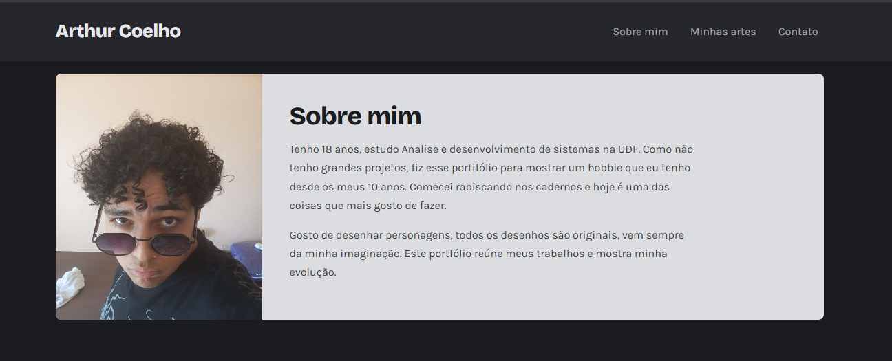
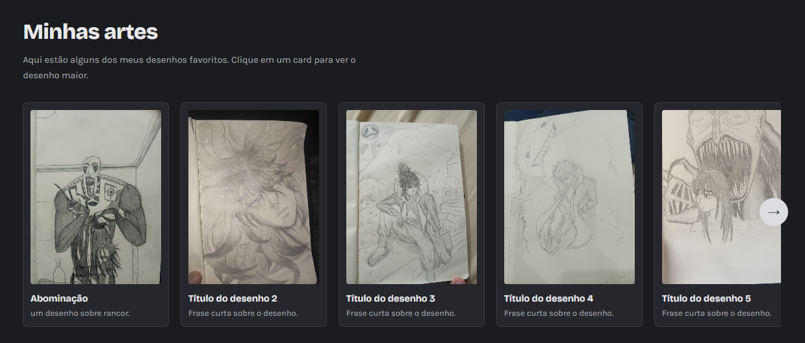
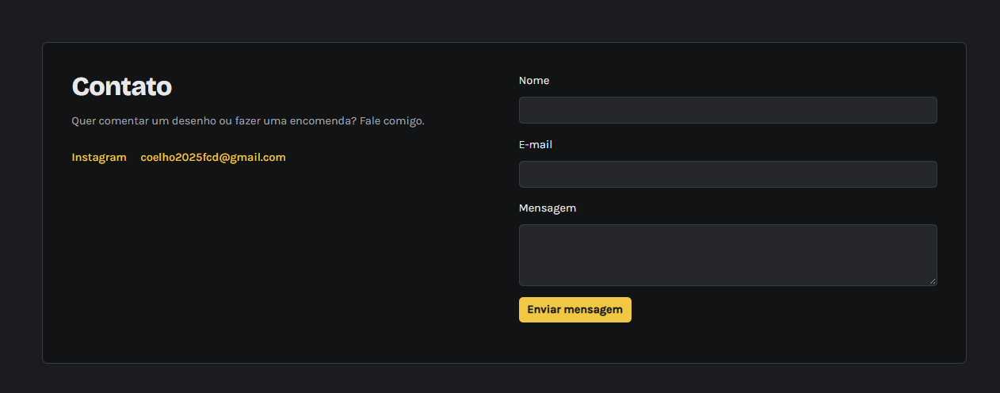

# Portfólio Pessoal — Arthur Coelho

**Site publicado:** [https://coelho-fcd-arthur.github.io/projeto_portifolio/](https://coelho-fcd-arthur.github.io/projeto_portifolio/)

## Visão geral e contexto

Este projeto é um portfólio pessoal para apresentar meus desenhos, minhas habilidades e meus projetos em um único local. Ele resolve a necessidade de divulgar meu trabalho de forma organizada, profissional e acessível, facilitando que visitantes conheçam meu perfil e entrem em contato.

O site foi desenvolvido como atividade acadêmica da disciplina de Desenvolvimento Front-end para Web, no segundo semestre de 2026.

## Tecnologias utilizadas

- HTML5 para a estrutura e semântica da página.
- CSS3 para layout responsivo, paleta visual, ajustes de aparência e animações.
- JavaScript para montar os textos, renderizar a galeria de desenhos, controlar o carrossel, abrir o modal e validar o formulário.
- Bootstrap 5.3.3, carregado via CDN, para componentes visuais e responsividade.
- Google Fonts para a tipografia Bricolage Grotesque e Karla.

O projeto é estático e não possui `package.json` nem dependências locais para instalação. Os recursos externos são carregados diretamente por CDN.

## Instruções de execução

### 1) Clone o repositório

```bash
git clone https://github.com/Coelho-fcd-Arthur/projeto_portifolio.git
cd projeto_portifolio
```

### 2) Abra o site localmente

Como o projeto é estático, não há necessidade de instalar dependências. Você pode abrir o arquivo `index.html` diretamente no navegador.

Também é possível rodar um servidor local usando o Node.js, caso queira testar em ambiente mais próximo de produção:

```bash
npx serve .
```

Depois, abra o endereço informado no terminal no navegador. Outra opção é usar a extensão Live Server do editor de código.

## Demonstração visual

### Sobre mim



### Galeria



### Contatos



## Licença

Este projeto usa a licença MIT. Consulte o arquivo [LICENSE](LICENSE) para ler o texto completo.

## Autor e contatos

**Arthur Coelho**

- GitHub: https://github.com/Coelho-fcd-Arthur
- Instagram: https://www.instagram.com/cueiodoroque
- E-mail: coelho2025fcd@gmail.com

## Observações finais

- O repositório foi preparado para uso público e documentação inicial.
- Os arquivos de imagem e texto podem ser adaptados em `dados.js` sem alterar a estrutura principal do projeto.
- O formulário de contato não deve expor credenciais em código público.
